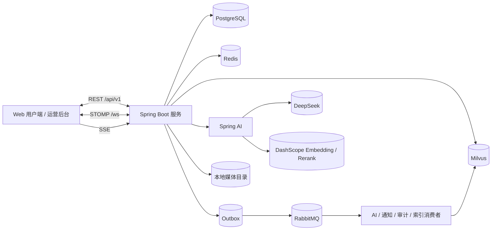
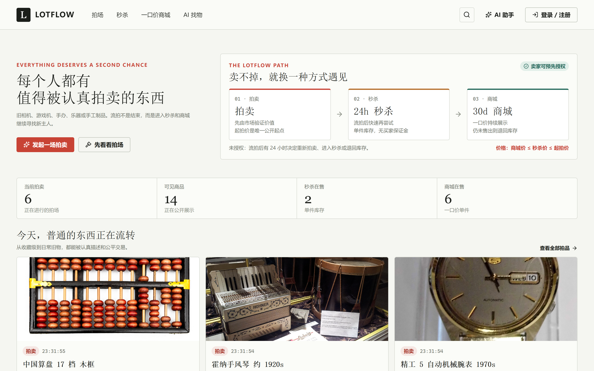
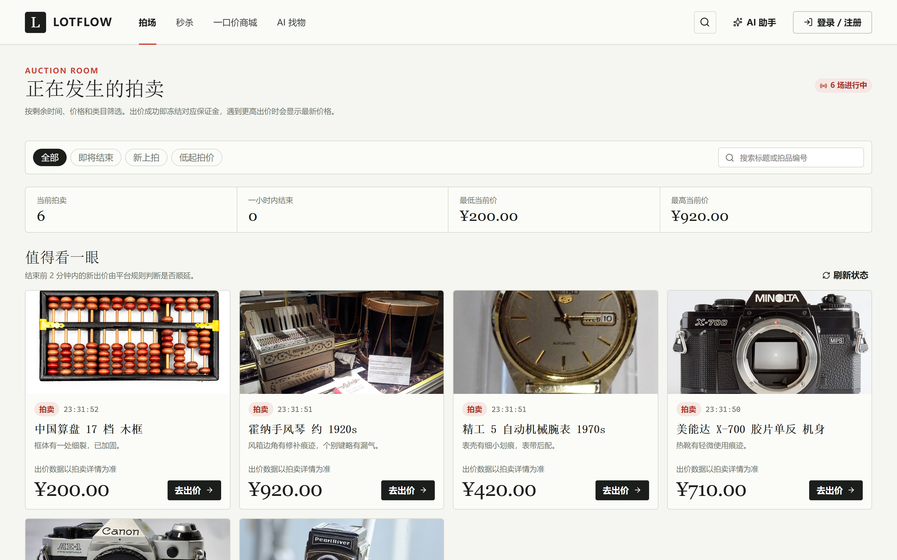
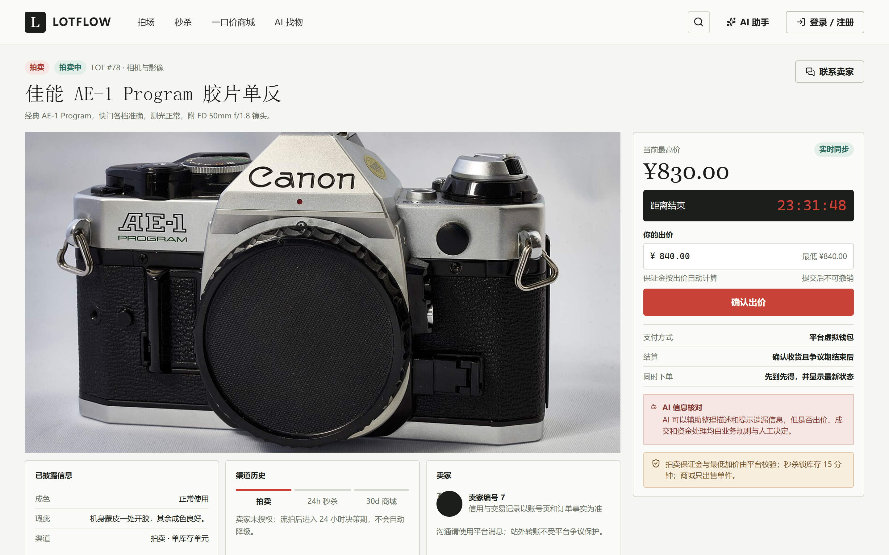
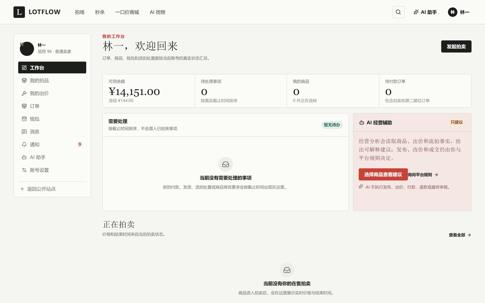
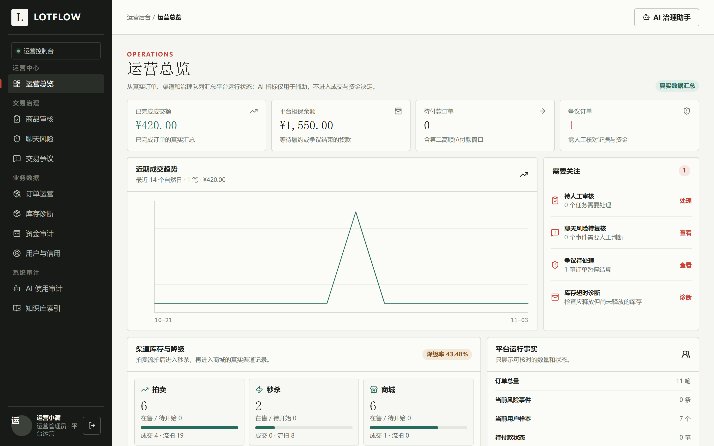
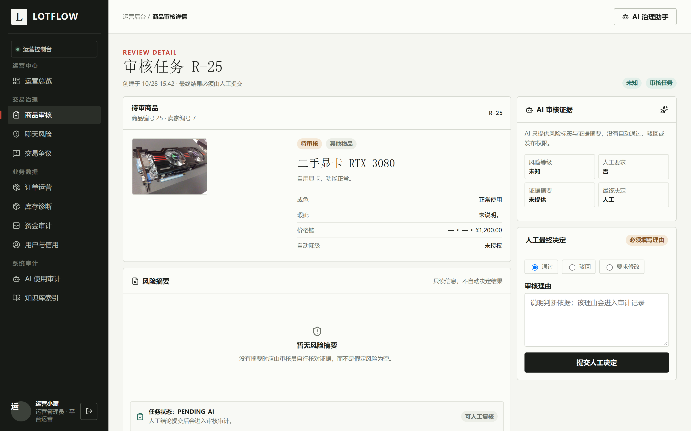
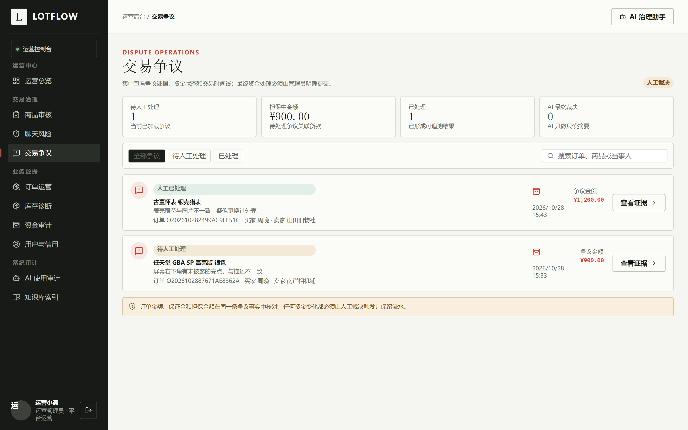
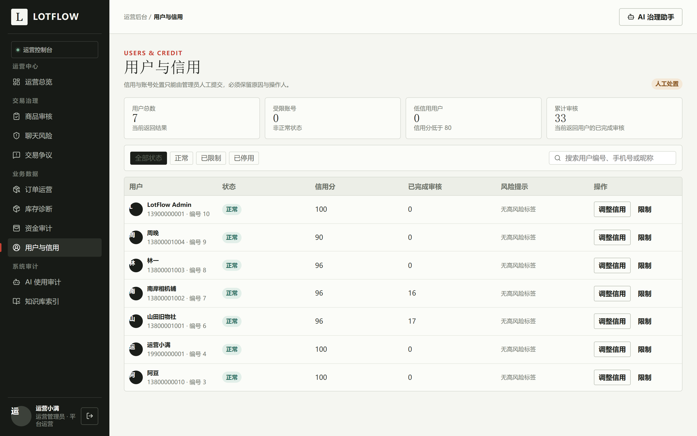

# LotFlow

**二手拍卖、秒杀与商城交易平台**

## 项目简介

LotFlow 围绕一件闲置商品的完整流转，将发布审核、公开拍卖、流拍决策、秒杀、一口价商城、订单履约和争议结算串成一条可追溯的业务链路。

系统同时包含 Web 用户端、运营后台和 Spring Boot 服务端，买家和卖家共用同一套用户体系，管理员通过独立运营入口处理审核、风险、争议和资金审计。交易与资金事实由 PostgreSQL 和服务端状态机维护，AI 仅用于发布辅助、审核初筛、混合搜索和经营建议。

## 核心能力

- **账号与权限**：手机号注册登录、Access/Refresh Token、设备会话撤销、用户与管理员角色隔离。
- **商品发布**：草稿编辑、图片上传、版本号更新、AI 商品草稿、提交审核及审核材料展示。
- **拍卖交易**：拍卖排期、买卖双方保证金、分档加价、防狙击顺延、并发出价、取消与违约赔付。
- **流拍与渠道**：卖家授权自动降级，或进入 24 小时决策期；拍卖、秒杀、商城严格单件库存。
- **秒杀与商城**：Redis Lua 原子预占库存、15 分钟订单锁、超时释放、30 天一口价销售。
- **订单与资金**：付款、发货、确认收货、第二顺位要约、担保结算、争议退款和信用调整。
- **消息与实时**：商品会话、消息序号、已读游标、站内通知、STOMP 实时推送与聊天风险提示。
- **AI 与检索**：平台规则 RAG、用户只读数据工具、关键词与 Milvus 向量混合搜索、查询重排。
- **运营后台**：商品审核、聊天风险、交易争议、订单、库存诊断、用户信用、AI 日志和知识库索引。

## 技术栈

| 组件 | 版本 |
| --- | --- |
| Java | 21 |
| Spring Boot | 4.1.1 |
| Spring AI | 2.0.1 |
| Spring Security | OAuth2 Resource Server + JWT |
| MyBatis-Plus | 3.5.17 |
| PostgreSQL | 18.6 |
| Redis | 8.10.2 |
| RabbitMQ | 4.3.6 |
| Milvus | 3.0.3 |
| Vue | 3.5.44 |
| TypeScript | ~6.0.0 |
| Vite | 7.3.7 |
| Pinia | 3.0.4 |
| Vue Router | 4.6.4 |
| Element Plus | 2.14.7 |
| Node.js | ^22.18.0 或 >=24.12.0 |
| Maven | 3.9+ |
| DeepSeek | 外部对话模型 API |
| DashScope | Embedding 与 Rerank API |

## 系统架构



REST 接口统一使用 `/api/v1` 前缀，由 JWT、角色权限和资源归属校验共同保护。实时消息通过 Redis Pub/Sub 跨实例广播，再由 STOMP 推送给当前实例连接；异步任务通过 Outbox 与 RabbitMQ 投递，避免交易事务直接依赖第三方服务。

## 代码结构

```text
backend/
├── pom.xml
└── src/main/
    ├── java/com/lotflow/
    │   ├── controller      REST 接口
    │   ├── service         业务接口与实现
    │   ├── ai              AI 任务、RAG、搜索与只读工具
    │   ├── domain          拍卖与价格领域规则
    │   ├── security        JWT、限流与当前用户
    │   ├── messaging       Outbox、RabbitMQ 消费者
    │   ├── websocket       STOMP 鉴权与实时广播
    │   ├── task            交易超时补偿任务
    │   ├── mapper          MyBatis-Plus 数据访问
    │   ├── entity          数据库实体
    │   ├── dto / vo        请求与响应模型
    │   └── config          安全、AI、Redis、MQ 与 WebSocket 配置
    └── resources/
        ├── application.yml
        ├── db/init.sql
        ├── knowledge/v1    平台规则知识库
        ├── prompts/v1      AI Prompt 版本
        └── redis           秒杀、限流与索引锁 Lua 脚本

web/src/
├── views/public      首页、拍场、秒杀、商城、搜索与详情
├── views/user        工作台、发布、订单、钱包、消息与助手
├── views/admin       审核、风险、争议、资金、用户与审计
├── components        通用组件与导航
├── layouts           公开站、用户中心、运营后台布局
├── stores            Pinia 登录态
└── api               REST、SSE 与令牌刷新

deploy/compose/       PostgreSQL、Redis、RabbitMQ、Milvus 编排
docs/screenshots/     README 运行截图
```

## 运行截图

以下截图来自项目实际运行环境。

### 用户端

<table>
  <tr>
    <td width="50%" align="center"><br /><sub>首页</sub></td>
    <td width="50%" align="center"><br /><sub>拍卖大厅</sub></td>
  </tr>
  <tr>
    <td width="50%" align="center"><br /><sub>拍品详情</sub></td>
    <td width="50%" align="center"><br /><sub>用户工作台</sub></td>
  </tr>
</table>

### 运营后台

<table>
  <tr>
    <td width="50%" align="center"><br /><sub>运营总览</sub></td>
    <td width="50%" align="center"><br /><sub>商品审核详情</sub></td>
  </tr>
  <tr>
    <td width="50%" align="center"><br /><sub>交易争议</sub></td>
    <td width="50%" align="center"><br /><sub>用户与信用</sub></td>
  </tr>
</table>

## 本地运行

### 环境要求

- JDK 21
- Maven 3.9+
- Node.js `^22.18.0` 或 `>=24.12.0`
- Docker Compose
- DeepSeek 与 DashScope API Key（使用 AI 问答、语义搜索和知识库时需要）

### 1. 获取代码

```powershell
git clone <repository-url>
cd LotFlow
```

### 2. 初始化数据库

在项目根目录启动 PostgreSQL、Redis 和 RabbitMQ：

```powershell
docker compose -f deploy/compose/docker-compose.yml up -d postgres redis rabbitmq
```

首次创建 PostgreSQL 数据目录时会自动执行 `backend/src/main/resources/db/init.sql`，创建业务表和三个平台钱包账户。已有数据目录不会重复执行初始化脚本。

使用语义搜索、AI 助手或知识库时，再启动 Milvus 及其依赖：

```powershell
docker compose -f deploy/compose/docker-compose.yml up -d etcd milvus-minio milvus
```

### 3. 配置运行环境

PowerShell 示例：

```powershell
$env:JWT_SECRET="replace-with-a-random-secret-of-at-least-32-bytes"
$env:DB_URL="jdbc:postgresql://localhost:5432/lotflow"
$env:DB_USERNAME="root"
$env:DB_PASSWORD="1234"

$env:REDIS_HOST="localhost"
$env:REDIS_PORT="6379"
$env:RABBITMQ_HOST="localhost"
$env:RABBITMQ_PORT="5672"
```

首次启动时可按需创建管理员：

```powershell
$env:ADMIN_PHONE="13900000001"
$env:ADMIN_PASSWORD="replace-with-a-strong-password"
$env:ADMIN_NICKNAME="LotFlow Admin"
```

AI 相关配置可按本机环境补充：

```powershell
$env:DEEPSEEK_API_KEY="your-deepseek-key"
$env:DASHSCOPE_API_KEY="your-dashscope-key"
$env:AI_VECTORSTORE_TYPE="milvus"
```

`JWT_SECRET` 少于 32 字节时服务会拒绝启动。未配置 AI 服务时，拍卖、订单、钱包和人工审核流程仍可使用，但语义搜索、AI 助手和相关建议能力会受限。

### 4. 启动服务

启动后端：

```powershell
cd backend
mvn spring-boot:run
```

服务默认监听 `8080` 端口，健康检查地址：

```text
http://localhost:8080/actuator/health
```

启动前端：

```powershell
cd web
npm ci
npm run dev
```

前端默认地址为 `http://127.0.0.1:5173`，Vite 会将 `/api` 与 `/ws` 代理到本地后端。

构建可执行包：

```powershell
cd backend
mvn clean package
```

构建前端静态资源：

```powershell
cd web
npm run build
```

## 主要配置

| 环境变量 | 默认值 | 说明 |
| --- | --- | --- |
| `DB_URL` | `jdbc:postgresql://localhost:5432/lotflow` | PostgreSQL 连接地址 |
| `DB_USERNAME` | `root` | 数据库用户名 |
| `DB_PASSWORD` | `1234` | 数据库密码，部署时务必覆盖 |
| `REDIS_HOST` | `localhost` | Redis 地址 |
| `REDIS_PORT` | `6379` | Redis 端口 |
| `RABBITMQ_HOST` | `localhost` | RabbitMQ 地址 |
| `RABBITMQ_PORT` | `5672` | RabbitMQ 端口 |
| `JWT_SECRET` | 无 | JWT 密钥，至少 32 字节，必须配置 |
| `ADMIN_PHONE` | 空 | 首次管理员手机号，可选 |
| `ADMIN_PASSWORD` | 空 | 首次管理员密码，可选 |
| `MEDIA_ROOT` | `../data/media` | 本地媒体存储目录 |
| `RATE_LIMIT_ENABLED` | `true` | 是否启用 API 分组限流 |
| `WALLET_RECHARGE_ENABLED` | `false` | 是否开启演示钱包充值 |
| `AI_VECTORSTORE_TYPE` | `none` | 向量库类型，使用 Milvus 时设为 `milvus` |
| `DEEPSEEK_API_KEY` | 空 | DeepSeek 对话模型密钥 |
| `DASHSCOPE_API_KEY` | 空 | DashScope Embedding / Rerank 密钥 |
| `AI_RAG_ENABLED` | `true` | 是否启用平台规则 RAG |

## 接口概览

| 模块 | 前缀 | 示例 |
| --- | --- | --- |
| 用户与登录 | `/api/v1` | `/auth/tokens`、`/users/me`、`/auth/sessions` |
| 商品与发布 | `/api/v1/listings` | `/submissions`、`/{id}/auction-schedules`、`/{id}/images` |
| 拍卖 | `/api/v1/auctions` | `/{id}/bids`、`/mine/bids` |
| 秒杀与商城 | `/api/v1` | `/seckill/{id}/orders`、`/shop/{id}/orders` |
| 订单 | `/api/v1/orders` | `/{id}/payments`、`/{id}/shipments`、`/{id}/disputes` |
| 钱包 | `/api/v1/wallet` | `/{id}`、`/transactions`、`/recharges` |
| 消息与通知 | `/api/v1/conversations`、`/api/v1/notifications` | `/conversations`、`/messages`、`/unread-count` |
| AI 与搜索 | `/api/v1/ai`、`/api/v1/search` | `/ai/tasks/{id}`、`/ai/assistant`、`/search/listings` |
| 运营后台 | `/api/v1/admin` | `/review-tasks`、`/disputes`、`/users`、`/reports` |
| 实时通道 | `/ws` | STOMP 连接、主题 `/topic/**` |

## License

仓库当前未附带独立 `LICENSE` 文件。对外开源、分发或商用前，需要补充明确的许可证并确认第三方依赖与截图素材的授权范围。
